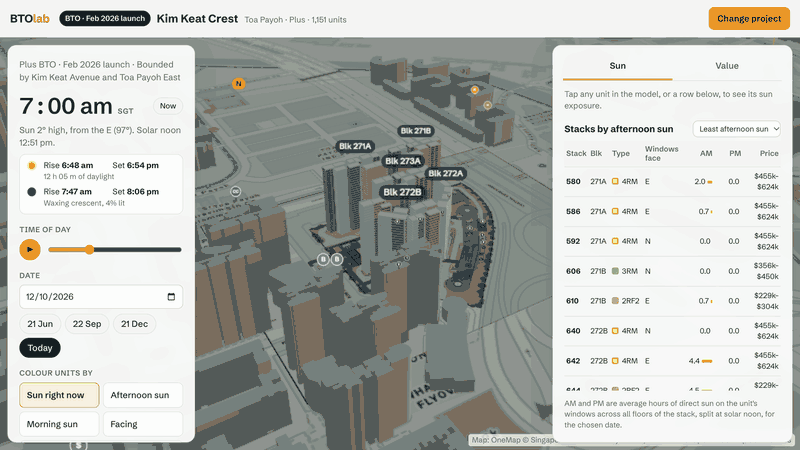
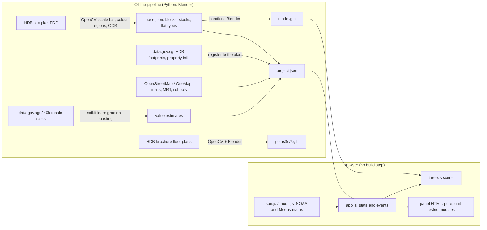

# BTOlab: Singapore BTO sun study

Pick a unit in an HDB BTO project and see how much direct sun reaches its windows, hour by hour and for any date. The
3D model is built from HDB's own site plan, with the real neighbouring blocks, schools, malls and MRT stations around
it, plus nearby resale prices and a machine-learning estimate of what the unit would resell for.

**Live:** https://singapore-housing-lab.vercel.app · 29 projects (every BTO launched from Oct 2025 to Jun 2026 except
Redhill Peaks II, plus the 7 upcoming Oct 2026 sites)



## Results

- **Resale value model:** 3.0% median error on 11,878 unseen recent sales. That is 3× more accurate than the town
  median price (9.2%) and 2× more accurate than a linear model (6.5%). The error holds at 2.9–3.7% across a 3-year
  backtest. Its price range is calibrated with split conformal prediction to hold 80.5% of unseen sales (target 80%).
  See [docs/model](docs/model/README.md).
- **3D in the browser:** 120 fps with up to about 300 extruded surrounding buildings, and about 1 MB downloaded per project.
  A size budget is enforced in CI. Lighthouse: Performance 95 on desktop and 84 on mobile, and 100 for Accessibility,
  Best Practices and SEO. See [docs/performance.md](docs/performance.md).
- **Accuracy of the sun model:** sunrise, solar noon and sunset are within 2 minutes of the US Naval Observatory, and
  moonrise and moonset within 5 minutes (`test/sky_test.mjs`).

## How it works



- **Sun and shade:** for each window the app computes the sun's position (NOAA equations, Singapore time). It then
  casts a ray towards the sun against the project's own blocks (as boxes) and the footprints of the neighbouring HDB
  blocks. A window counts as sunlit only when it faces the sun and nothing blocks the ray. The outer ring of
  surrounding buildings is shown for context but not used for shading.
- **Static site:** plain ES modules and an import map, hosted on Vercel. Each project is one JSON file plus one GLB.

## Key decisions

| Decision | Why |
|---|---|
| Split train and test by time, not at random | The model prices the future from the past. A random split leaks each block's own recent sales and flatters the error. |
| Compare with town-median and linear baselines | A model error means little without a simple baseline beside it. |
| Never place a block at a guessed location | Unlinked blocks are dropped rather than drawn wrong; a wrong shadow is worse than none. |
| Bake the models in Blender offline | The browser downloads a small, ready-made GLB instead of building geometry at load time. |
| Merge the surroundings into one mesh per kind | About 300 extra buildings cost 3 draw calls, so the frame rate stays at 120 fps. |
| Don't publish HDB brochures and site plans | Copyright: the app links to HDB's own pages, and only the floor-plan crops are published. |

## Tests

18 test scripts run in CI on every push (`npm test`, the same command locally). The parts that need HDB's brochures,
site plans or large data.gov.sg files print "skipped" in CI and only run on a machine that has them:
- sun and moon times against the US Naval Observatory;
- the side-panel HTML renderers on a real project;
- the resale model's quality bars;
- per-project download budgets;
- the site-plan tracer and the floor-plan and surroundings extractors;
- the app in a real browser (Playwright): it loads, and a unit can be picked again after clearing the selection;
- that the project catalogue is up to date.

## Development

```
projects/index.json          catalogue (node tools/make_index.js)
projects/<id>/project.json   site, plan scale/north, blocks, stacks, unit types, neighbouring blocks
projects/<id>/trace.json     what was read off HDB's site plan (BTOs)
projects/<id>/siteplan.jpg   site plan laid on the ground
projects/<id>/model.glb      generated — do not edit (node tools/build.js projects/<id>)
web/                         the app (no build step): open /web/ or /web/?p=<id>
blender/build_model.py       layout.json -> study model GLB (unit bodies carry a _UNIT attribute for colouring)
tools/                       derive, build, trace_siteplan, find_scalebar, grid_tiles, fetch_context,
                             make_bto_project, make_upcoming, make_index
test/sun.test.js             ported logic must reproduce the original Thomson Reserve table (kept out of the catalogue)
```

## Run

```
python3 -m http.server 8781          # then open http://localhost:8781/web/
npm test
```

## Add a launched BTO

1. Put HDB's site plan in `reference/hdb/siteplans/<slug>.jpg` and an entry in `reference/hdb/launched.json`.
2. `python3 tools/find_scalebar.py <plan> x0 y0 x1 y1` → scale bar ends; write `projects/<slug>/trace.json`
   (planBox, scale, legend swatch points per flat type).
3. `python3 tools/trace_siteplan.py projects/<slug> --regions` → `regions.png`; name each stack by region id
   (`"r12"`, or `"r12.a"`/`"r12.b"` for the left/right half of a shared region) or a full-image point; add
   `types` overrides where colour matching is ambiguous. Run without `--regions` and check `trace-debug.png` and
   the flat-type counts against HDB's block table.
4. `python3 tools/make_bto_project.py <slug>` (approximate georeference + neighbouring HDB blocks from data.gov.sg/OneMap).
5. Align the neighbours to the plan: `python3 tools/register_context.py projects/<slug> --apply` fits the footprints onto
   the existing blocks drawn on the sheet (accepted only when ≥65% of on-sheet edges land on drawn outlines). If it
   can't, pin with printed block numbers — `python3 tools/anchor_fit.py projects/<slug> 269:298,964 266:329,1436`
   (block : plan pixel of its label) — then `register_context.py --range 25 --apply`. Check with
   `python3 tools/overlay_context.py projects/<slug> out.png`; `python3 tools/drop_overlaps.py projects/<slug>` removes
   demolished blocks under the new towers.
6. Amenities: `python3 tools/trace_facilities.py projects/<slug>` reads the numbered estate facilities off the site plan
   (legend + markers, OCR); `python3 tools/fetch_amenities.py projects/<slug>` adds nearby MRT/LRT, bus stops,
   schools, preschools, hawker centres, supermarkets, clinics, parks, libraries and CCs from
   `reference/amenities/all.json` (built by `python3 tools/build_amenities.py` from data.gov.sg + OneMap).
7. `node tools/build.js projects/<slug>`, `node tools/make_index.js`.

Projects live outside `~/Documents`: macOS revokes access when Blender is launched on files there.

## Limits

- Shading is tested against simple boxes (as in the original), not the balcony detail in the GLB.
- Stepped blocks are modelled at their tallest height; HDB's plans don't say which stacks step down.
- Neighbouring blocks are fitted to the plan where the sheet draws them; greenfield sheets (e.g. Sembawang, Mount
  Pleasant) show none, so those sites keep their address/pin placement (typically within ~20 m).
- Base map: OneMap Grey tiles © Singapore Land Authority, loaded live around each site.
- Amenity distances are straight-line from the site centre, not walking routes; facility numbers are OCR'd from the
  site plan and can occasionally be misread.

## Data not in this repo
HDB's site plans, sales brochures and launch annexes are not committed. After cloning, re-create them locally:
download site plans (`reference/hdb/launched.json` lists the projects), then run `tools/trace_siteplan.py` (writes
`siteplan.jpg`). Until then the app runs without the site-plan overlay. Open data (HDB buildings / property
information, amenity layers, resale prices) is re-downloaded from data.gov.sg by the tools.

Each stack's floor-plan crop (`projects/<id>/layouts/`, cut from HDB's sales brochure by `tools/extract_layouts.py`)
is committed so the deployed site can show it; the unit card also links to the page in HDB's own published brochure
(`project.json["brochure"]`, assets.hdb.gov.sg). Floor plans © Housing & Development Board.
