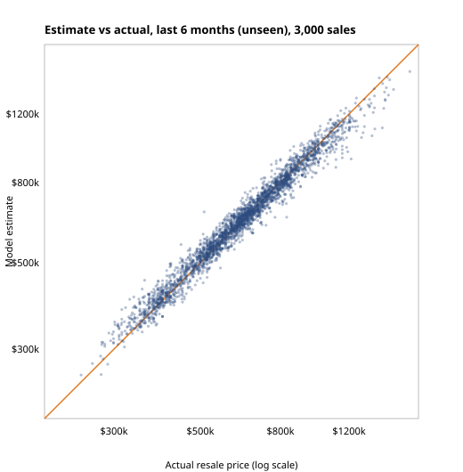

# Resale value model

The Value tab estimates what a BTO unit would resell for today. Numbers below were produced by
`tools/eval_value.py` and are stored in [`eval.json`](eval.json).

## Data

- **Sales:** every HDB resale transaction from Jan 2017 to Oct 2026 (data.gov.sg), about 242,000 sales.
- **Location:** each block's coordinates come from OneMap (`tools/geocode_resale.py`). Every sale was matched to a location; none were dropped.
- **Amenities:** MRT/LRT stations, malls, hawker centres and primary schools (`reference/amenities/all.json`).

## Features

| Group | Features |
|---|---|
| Unit | flat type, flat model, floor area, middle of the storey range, remaining lease |
| Time | sale month (so the model learns the market trend) |
| Location | town, distance to the nearest MRT/LRT station, mall and hawker centre, distance to Raffles Place, number of primary schools within 1 km |

## Model

- **Algorithm:** gradient-boosted trees (scikit-learn `HistGradientBoostingRegressor`, 500 iterations, native categorical splits). The target is `log(price)`, so errors are relative.
- **Price range:** the Value tab shows a range as well as the estimate. The range is the 10th to 90th percentile of `log(actual / estimate)` on recent sales the model had not seen.
- **How the range is checked:** the band is fitted on months 1–3 of the test window and checked on months 4–6, so the check doesn't reuse the data that set the band.

## Validation: time-based split

Training uses every sale up to the cut-off. Testing uses the **6 months after** the cut-off. This is the way the model is
used in practice (it prices the future from the past). A random split would leak each block's own recent sales into
training and make the error look smaller than it is.

**Latest test window: 11,878 sales the model never saw.**

| Method | Median absolute % error |
|---|---|
| **Gradient-boosted model** | **3.0%** |
| Linear model (Ridge, same features) | 6.5% |
| Town × flat-type median price (last 12 months) | 9.2% |
| Town × flat-type median $/sqm × floor area | 9.6% |

- 71% of estimates are within 5% of the actual price, and 93% are within 10%.
- The 10–90% range contains the actual price **77%** of the time. The target is 80%, so the range is slightly too narrow.



## Stable over time (backtest)

The same split was repeated at earlier cut-offs. Each run trains a fresh model that never sees its 6 test months.

| Test window | Sales | Median % error |
|---|---|---|
| Nov 2023 – Apr 2024 | 13,292 | 3.3% |
| May 2024 – Oct 2024 | 14,631 | 3.7% |
| Nov 2024 – Apr 2025 | 12,641 | 3.2% |
| May 2025 – Oct 2025 | 12,803 | 2.9% |
| Nov 2025 – Apr 2026 | 11,657 | 2.9% |
| May 2026 – Oct 2026 (latest) | 11,878 | 3.0% |

The error stays between 2.9% and 3.7% in every window: the model does not depend on one lucky period.

## Where it is weaker

| Segment | Median % error | Why |
|---|---|---|
| Marine Parade, Bukit Timah, Central Area | 5.0–5.5% | Few sales (27–87 in the window) and very mixed blocks |
| Bukit Merah | 4.1% | Old and new blocks side by side |
| Multi-generation flats | 11.6% | Only 5 sales in the window |
| Tampines, Pasir Ris, Choa Chu Kang | 2.4–2.6% | Many similar sales |

By flat type the error is 2.9–3.3% for 2-room to Executive. By floor it is 3.0–3.2% for every band from low to 25+ floors.
The full table is in `eval.json`.

## Limits

- A BTO unit has no sales history of its own. The model prices a similar resale flat in the same place, valued as if
  it were sold today with a full lease. It is not a forecast of the price after the 5-year minimum occupation period.
- Missing features: the view, noise, renovation and exact orientation. The town median of these is absorbed into the town feature.
- Towns with no resale history (for example Tengah) borrow the nearest town that has sales (`tools/train_value.py`).

## Reproduce

```bash
python3 tools/train_value.py train      # model + value-metrics.json
python3 tools/eval_value.py             # baselines, segments, backtest -> docs/model/
```

`eval_value.py` takes about 2 minutes on a laptop, because it trains 6 models of about 230k rows each.
