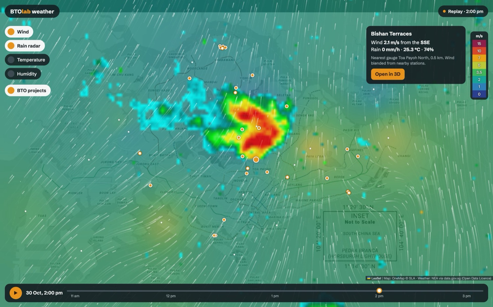
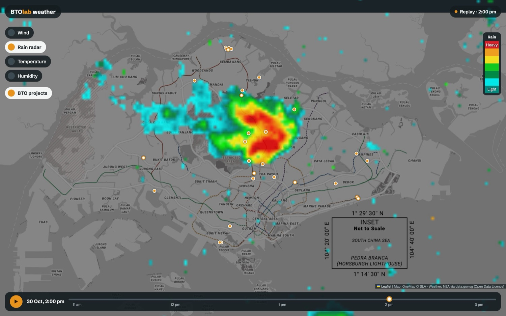
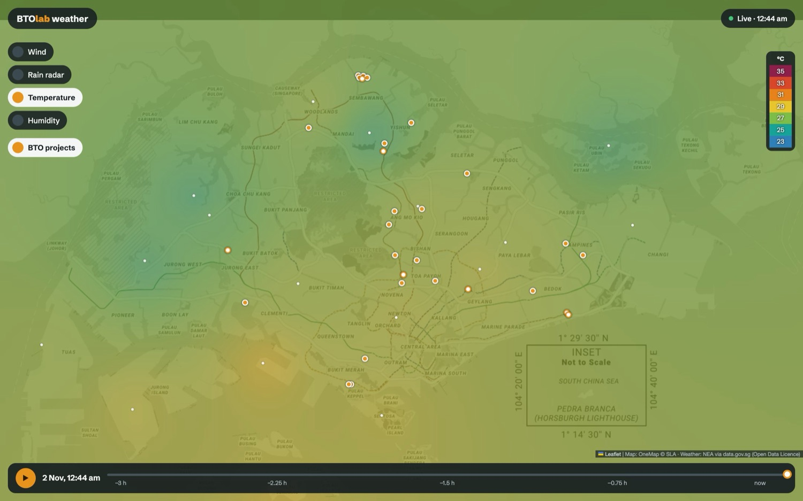
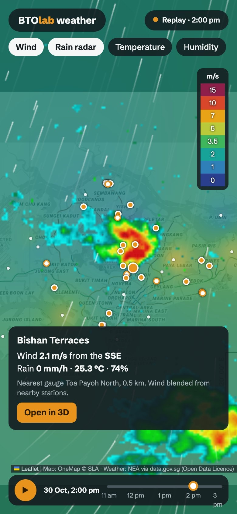
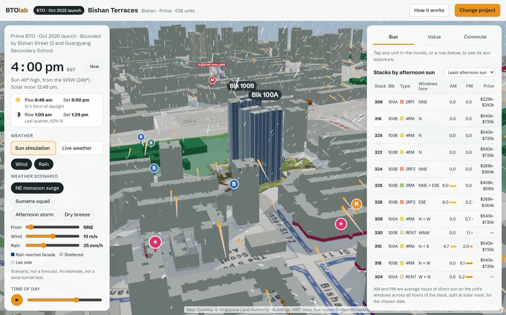
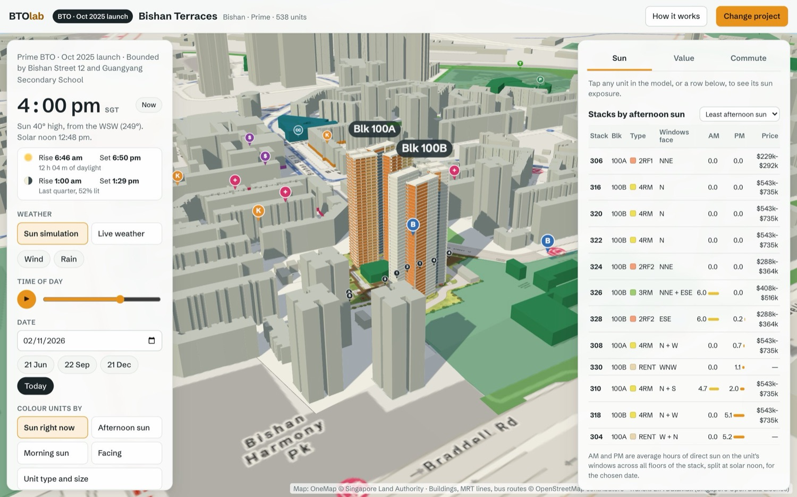
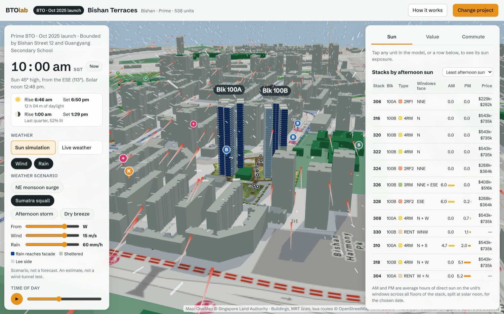
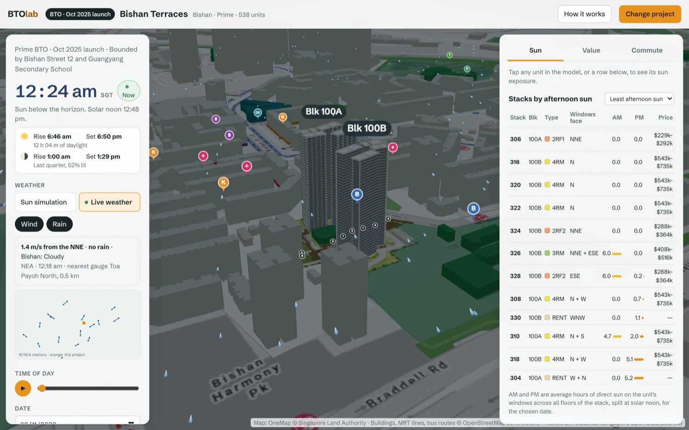

# Singapore weather simulation, and wind and rain for every BTO project

**Status:** proposal for review. Nothing is built. Screens below come from throwaway prototypes, and the weather in them is real NEA data.

## The idea

Two things, built in this order:

1. **A new weather simulation page.** A full-screen map of Singapore in the style of Ventusky: animated wind, rain radar, temperature and humidity, a timeline to replay the last few hours, and every BTO project pinned on the map. It runs on real NEA readings.
2. **Wind and rain inside each project's 3D view.** This answers what a map can't: which windows take the rain and which catch the wind.

They connect: clicking a project on the map opens its 3D view, and the 3D view links back to the map. Both share one weather data module.

*Prototype: a real storm over Ang Mo Kio and Bishan at 2 pm on 30 Oct 2026, with real wind from 16 NEA stations.*

## What the research found

### Ventusky

Viewed at your link, zoomed out over Southeast Asia, with its public pages read.

| Ventusky does | The simulation page does |
|---|---|
| Animated wind streaks over a speed colour field | The same, from NEA stations |
| A rail of pill buttons for layers | The same, with 4 layers |
| A fixed colour legend at the side | The same |
| A timeline with Play | The same, for **past** hours |
| Forecasts days ahead from weather models | **Not possible from NEA data** (see below) |
| Regional view of a continent | Island view, at street-map detail |

**The main difference is what the data is.** Ventusky animates model output on a global grid. BTOlab would animate real measurements from a small network of stations. That makes it more truthful about right now, but it has no gridded future. The page shows **now and the recent past**, plus NEA's two-hour forecast as text.

### Singapore live data

I called these directly on 2 Nov 2026. All sit under `api-open.data.gov.sg/v2/real-time/api/` and allow browser calls (`access-control-allow-origin: *`). The app sets no content security policy that would block them.

| Endpoint | Coverage | Reading | Notes |
|---|---|---|---|
| `wind-speed` | 16 stations | 1-minute average at 10 m | **Unit is knots**, not m/s |
| `wind-direction` | 16 stations | Degrees | The direction it blows from |
| `rainfall` | 88 gauges | 5-minute total in mm | Multiply by 12 for mm/h |
| `air-temperature` | 17 stations | °C | |
| `relative-humidity` | 17 stations | % | |
| `two-hr-forecast` | 47 areas | Text such as "Cloudy" | A forecast, updated every 30 minutes |
| `weather-radar-images/70km` | About 140 km across | 480 × 480 transparent PNG | **Beta.** Also `/240km` and `/480km` |
| `weather?api=lightning` | Island | Strike list | Available for later, empty when I checked |

**Findings that shape the design:**

- **Radar works in the browser.** It returns a bounding box, a timestamp and a PNG link. One pixel is about 290 m, which suits a map but is too coarse for a 2.5 km project scene.
- **Radar lines up with the ground.** For the 30 Oct frame, 11 of the 13 gauges recording rain sat under a radar echo, against 5 of the 75 dry ones. That is one frame, not a full validation.
- **History exists.** Adding `?date=2026-10-30T14:00:00` returns that moment, which is what makes a timeline possible.
- **Whole-day requests are impractical.** They return 25 readings per page, so a full day of minute-by-minute wind would take around 58 calls. The timeline asks for single moments instead.
- **Radar links expire after about 20 minutes,** so each image must be loaded when fetched and kept in memory.
- **Rate limit:** 6 calls per 10 seconds without a key. I tripped it during research, so it's real and the page must queue its calls.
- **Licence:** the radar dataset page states the Open Data Licence, free for personal or commercial use. Confirm the same for the others before launch, and credit NEA on the page.

### The API key

**The page does not need one, and it should not go in the page.** Anything in browser code can be read by every visitor.

The key you supplied also made no measurable difference. Quick bursts of 10 calls gave 6 successes with it and 6 without it, against 12 documented for a developer key. A made-up key also returns 200, so the status code says nothing about validity. Either the key isn't active for this API, or I sent it the wrong way: I used the `x-api-key` header, and the limits page doesn't name one. The key is not stored in this document or in the repo.

It becomes useful only with a shared server cache, listed under later work.

### Singapore's weather patterns

From the Meteorological Service Singapore climate page. These set the 3D view's scenarios.

| Scenario | When | Wind | Source says |
|---|---|---|---|
| NE monsoon surge | Dec to early Mar | From N to NE | Mean wind can reach 10 m/s or more, with widespread rain |
| Sumatra squall | Jun to Sep, predawn to midday | Line moves eastward | Gusts of 40 to 80 km/h |
| Afternoon storm | Late Mar to May, Oct to Nov | Light and variable | Afternoon and evening thunderstorms |
| Dry breeze | Late Jan to early Mar | From N to NE | February is the windiest month at 2.8 m/s and the driest |

**The rain rates in the prototype (25, 60 and 40 mm/h) and the storm's 5 m/s are my illustrative values**, not MSS figures. Sliders let the user set their own.

## Part 1: The simulation page

### What's on it

- **Layer rail:** Wind, Rain radar, Temperature, Humidity. Wind and Rain can be on together. Temperature and Humidity each replace the colour field.
- **Timeline:** Play and a slider over the last 3 hours in 15-minute steps, ending at "now".
- **Status chip:** "Live · 12:44 am", or "Replay · 2:00 pm" in a different colour, so a replay can't be mistaken for now.
- **Project pins:** all 29 projects. Clicking one shows its wind, rain, temperature and humidity, with an **Open in 3D** button.
- **Station dots:** a small dot wherever a real measurement exists, so users can see how sparse the data is.

*Rain radar on its own, same real frame. The legend colours here are approximate. The real scale is in NEA's API spec, which still has to be read.*

*Temperature from a live reading at 12:44 am on 2 Nov. Dots mark the stations. The timeline labels are placeholders.*

### How it works

| Piece | Approach |
|---|---|
| Map | Leaflet 1.9.4 from the CDN, using the OneMap tiles the 3D view already uses |
| Wind | Blend the stations by inverse distance on each particle's position, as vectors, and draw about 1,700 trails on a 2D canvas (650 on phones) |
| Colour fields | The same blend on a coarse grid, stretched over the map |
| Radar | The PNG placed by its bounding box |
| Pins | `tools/make_index.js` adds each project's lat and lon to `index.json` |

The page stays static with no backend, like the rest of BTOlab.

### Staying inside the rate limit

Every call goes through one queue, at one call per 1.7 seconds.

| When | Calls | Time |
|---|---|---|
| Page opens | 7: radar first, then the rest | About 12 s, with the map usable at once |
| Timeline fills in behind that | 1 per radar frame, 12 frames | About 20 s |
| User pauses on a past moment | 5 for that moment's stations | About 8 s, then kept in memory |
| Staying on Live | Wind each minute, the rest every 5 minutes, forecast every 30 | Well under the limit |

Play therefore always has radar straight away, and past wind appears only for moments that have been loaded. Polling stops when the tab is hidden. The limit appears to apply per visitor rather than to the whole site, but NEA's guide doesn't state that, so treat it as an assumption until tested. A shared office network could also hit it, so a 429 response backs off and says so.

### What this page can't claim

- **Between stations, the colours and trails are estimates.** 16 wind stations can't show local gusts or the wind over the sea, and blending smooths everything.
- **The trails show the current wind, not a physical simulation.** There is no modelling of air movement.
- **Radar is not ground truth.** NEA warns it can pick up reflections from sources other than rain.
- **No forecast map.** See the Ventusky comparison above.

Suggested wording on the page: *"Measured at NEA stations and estimated between them."*

### Failure and access

| Case | What the user sees |
|---|---|
| A feed fails | Other layers keep working, and that layer's button shows it's unavailable |
| Reading over 15 minutes old | The status chip shows its age |
| Radar beta changes or goes down | Rain falls back to gauge dots |
| `prefers-reduced-motion` | No moving trails, just static arrows at the stations |

*Phone. The real version needs the project card as a smaller bottom sheet, and shorter timeline labels. The band at the top is where the prototype's colour layer and map tiles end.*

## Part 2: Wind and rain in the 3D view

The finding that makes this cheap: **the sun ray-caster already answers the rain question.** Wind-driven rain falls along a straight slanted line, so it can go through `unitSun()` in `web/sun.js` like a sun ray.

*Scenario at Bishan Terraces: rain from the NNE at 10 m/s, windward faces in blue, wind trails coloured by speed.*

### The spike: does the rain ray work?

I ran it on all 23 projects with a layout, in Node, with no changes to the app.

**A rain ray** is `sunVec(atan(Vt / U), windFrom)`. `U` is the wind speed at that floor and `Vt` is 6.5 m/s, roughly a 2 mm raindrop. `unitSun()` then returns:

| Sun result | Means for rain |
|---|---|
| `lit` | Rain reaches this facade |
| `shade` | Facing the rain, but a neighbouring block shelters it |
| `away` | On the lee side |

**Results:**

- **Stacks differ sharply, which is what a buyer needs.** At Bishan Terraces, stack 306 is 100% reached in the NE surge and 0% in the squall, while stack 302 is the reverse.
- **Projects differ too.** The share of units reached in the NE surge runs from 19% (Kim Keat Crest) to 55% (Sembawang Brook).
- **It is fast.** About 1.7 ms per 1,000 units in Node, so moving a slider can repaint instantly.

**One flaw it exposed: a yes/no answer misleads in light rain.** In a 2 m/s shower, about half of all units count as "reached", yet the rain is almost vertical and barely touches the wall. So colour by strength: `rain rate × (U / Vt) × cos(angle to facade)`. `unitSun()` already returns the cosine part.

### Options considered

| | A. Ray-cast exposure and scene effects **(recommended)** | B. Embed Ventusky | C. Real wind simulation (CFD) |
|---|---|---|---|
| Answers "which of these stacks?" | Yes, as an estimate | No | Yes, most accurately |
| New code | Small | Tiny | A new pipeline per project and direction |
| Backend needed | None | None | Heavy batch compute |

**A** is the only one that answers the buyer's question at a sensible cost. **C** can follow later if buyers rely on A.

### Controls

Two buttons in a new **Weather** block under the sky card, built from the existing `.mode` and `.chip` styles. **Sun is never off.**

*Default: Sun simulation, Wind and Rain off, and no weather calls.*

| Action | What happens |
|---|---|
| Open any project | Sun simulation, Wind and Rain off, **no network calls for weather** |
| Turn on Wind or Rain | Scenario panel opens: 4 presets, plus From, Wind and Rain sliders |
| Press **Live weather** | Saves date, time and layers, then follows the clock, fetches NEA data and turns on Wind and Rain |
| Press **Sun simulation** | Stops polling, cancels requests, restores the saved date, time and layers |
| Move the time slider, date, presets or Play while live | Leaves Live and keeps the time just chosen, because live weather is only true for now |
| Change project | Page reloads with `?p=`, so it starts again in Sun simulation |

Leaving Live on a time change takes one line in the existing `setLive(false)`, which all of those controls already call.

### Showing sun, wind and rain

| | In the 3D scene | On the units |
|---|---|---|
| **Sun** | Unchanged. In Live, the forecast text dims the sunlight and greys the sky | Unchanged |
| **Wind** | Trails coloured by speed, stopping where they meet a block | New **Wind exposure** colour mode |
| **Rain** | Slanted streaks that stop at roofs, so the lee of a block stays visibly clearer | New **Rain reach** colour mode |

The two colour modes join the existing **Colour units by** list, and they reuse `paint()` and `legendHtml()`. Wind exposure uses the same ray-caster with a horizontal ray. The stack table and unit card gain one line for the selected mode.

*Same project, squall from the west: the wet faces change completely.*

### Live weather in 3D

*Real readings at 12:18 am on 2 Nov 2026: 1.4 m/s from the NNE, no rain, Bishan cloudy. The small station map here would become a link to the simulation page.*

**One value per project:**

- **Wind:** the 3 nearest stations by inverse distance squared. Average as vectors, never as angles, since 350° and 10° must average to 0°, not 180°.
- **Rain:** the nearest gauge with a reading, multiplied by 12.
- **Sky:** the forecast text for the nearest of the 47 areas.
- **Height:** `U(z) = U10 × (z / 10)^0.25`, so upper floors get more slanted rain. The exponent is my assumption for a built-up area.

If a fetch fails, the view keeps the last values with "Live weather unavailable, retrying". Readings over 15 minutes old are labelled, and their rain and wind effects are removed. It never flips back to simulation on its own, so a scenario can't be mistaken for live weather.

### Performance and access

- **Rendering:** one `InstancedMesh` each for rain and wind, since the prototype showed plain WebGL lines are stuck at 1 pixel and nearly invisible.
- **Counts:** about 3,200 rain streaks on desktop and 1,000 on phones.
- **Collision:** there are 16 project boxes but **815 surrounding buildings** at Bishan Terraces, too many to test each frame. Bake them into a 2D height grid, 5 m per cell. The prototype only tested the 16.
- **Reduced motion:** no moving particles, only unit colours and a static wind arrow.
- **Upcoming projects:** the 7 upcoming sites with no layout get effects and readout, but no unit colours.

### What the 3D view can't claim

- **"Reaches the facade" does not mean "enters your window".** Ledges, planters and balconies aren't modelled.
- **Wind travels in straight lines here.** No funnelling, gusts or eddies. It shows exposure, not airflow.
- **Rain is one drop size, and wind comes from a 10 m station** that may be several kilometres away.
- **Not an ISO 15927-3 driving rain index.** That standard excludes places where over 25% of annual rain comes from severe convective storms, which may well include Singapore.

Suggested wording in the app: *"An estimate from wind direction and building shapes, not a wind-tunnel test."*

## Plan

Each phase ships as its own PR.

### Phase 1: Simulation page, live

- **`web/weather.js` (new, pure, runs in Node):** fetch with a `base` test seam like `fetchArrivals` in `web/live.js`, the call queue, parsing, knots conversion, and vector blending.
- **`web/weather.html`, `web/weather-page.js` (new):** map, 4 layers, wind trails, legend, status chip, station dots, project pins and readout.
- **`tools/make_index.js`:** add `lat` and `lon` to each project in `index.json`.
- **`web/index.html`:** a link to the page. **`tools/build_seo.js`:** add it to the sitemap.
- **Before coding the rain legend:** read the colour scale in NEA's radar API spec.
- **Tests:** `test/weather_test.mjs` and a browser test with mocked responses:
  - Knots convert correctly, and 350° and 10° blend to 0°.
  - Missing stations are skipped.
  - The queue never exceeds 6 calls in 10 seconds.
  - A failed feed leaves the other layers working, and a 429 backs off.

### Phase 2: Timeline

- 3-hour radar frames that load in the background, with station data on pause.
- The Replay status chip, Play and slider.
- **Tests:** frames load in order, an expired link is re-requested, and returning to "now" resumes Live.

### Phase 3: Scenario weather in 3D

- **`web/weather.js`:** `rainVec`, wind at height, `computeWeather(L, wx)` modelled on `computeNow`.
- **`web/scene.js`:** `makeRain`, `makeWind` and the height grid. **`web/unit.js`:** legend and unit card lines.
- **`web/index.html`, `web/style.css`, `web/app.js`:** Weather block, 2 colour modes, state, and a tick in `loop()`.
- **Tests:** stack 306 at Bishan Terraces is reached in the surge and not in the squall, zero wind gives no facade reach, and `test/sun.test.js` still passes untouched.

### Phase 4: Live weather in 3D

- The two-button switch, saving and restoring state, reusing Phase 1's data module.
- **Tests:** **opening a project makes no weather calls**, Sun simulation restores the saved time, and moving the slider leaves Live.

**Left out on purpose:**

- Forecast maps, which need a model source such as Open-Meteo (reported as non-commercial on its free tier).
- 24-hour or longer replay. This and fuller wind history need a shared server cache, for example a cached route in `sg-bus-api`, and that's where your API key would live.
- Lightning, UV and air quality layers, gusts, and year-round breeze scores. Any could follow if people use the page.

## Decisions for you

I've chosen defaults so the work can proceed. Each is easy to change now.

1. **The simulation page comes first,** as you asked, ahead of the 3D work. It also gives the 3D work its data module.
2. **No API key and no backend in the first version,** since the feeds work without one.
3. **The timeline covers the last 3 hours only,** which is what the rate limit allows without a server cache.
4. **In 3D, Sun simulation restores the earlier date and time,** and colours show exposure strength rather than yes/no.

## Sources

- [Ventusky](https://www.ventusky.com/?p=4.6;101.0;4&l=wind-10m), [about](https://www.ventusky.com/about), [data sources](https://www.ventusky.com/sources)
- [Weather Radar Images, beta](https://data.gov.sg/datasets/d_418e9ac3414fd927b7405631e0a7bc82/view)
- [NEA 2-hour forecast on data.gov.sg](https://data.gov.sg/datasets/d_3f9e064e25005b0e42969944ccaf2e7a/view), and the live endpoints called directly
- [data.gov.sg API rate limits](https://guide.data.gov.sg/developer-guide/api-overview/api-rate-limits)
- [Meteorological Service Singapore, climate of Singapore](https://www.weather.gov.sg/climate-climate-of-singapore/)
- [ISO 15927-3:2009](https://www.iso.org/standard/44281.html), scope and exclusions
- [Open-Meteo](https://open-meteo.com/) terms, from secondary sources only
- Not independently verified: `Vt` of 6.5 m/s and the rain-flux form are textbook values from memory, and the 0.25 wind exponent is an assumption.
